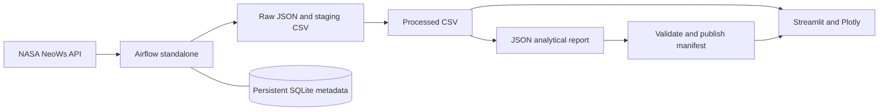
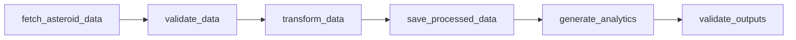
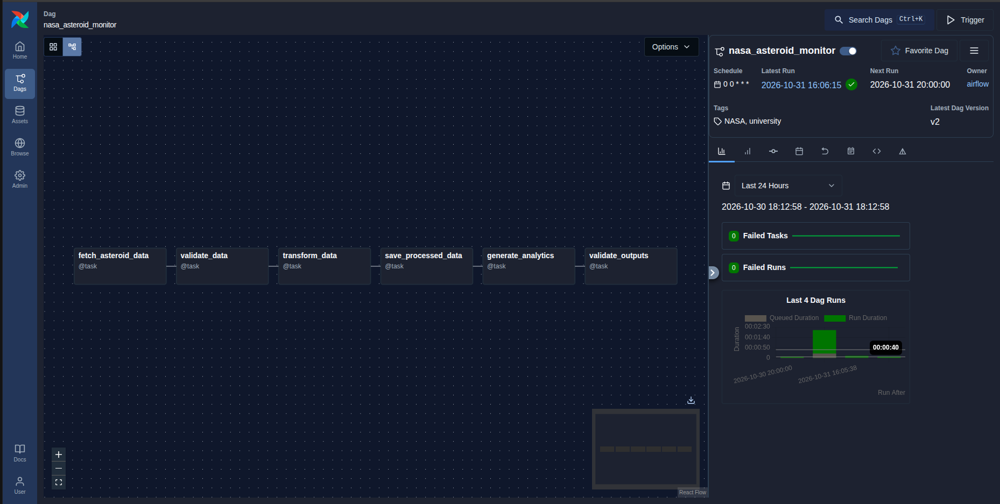

# MLOps - Lab 3 - Airflow

## Problem statement

Public asteroid feeds are nested JSON documents. A repeatable pipeline makes the data easier to inspect, validates measurements before analysis, and provides an understandable example of scheduled orchestration. This application describes NASA approach data; it does **not** predict collisions. A potentially hazardous classification does not mean an imminent threat.

## Project objectives

- Learn six TaskFlow tasks, dependencies, scheduling, retries, and file-based handoffs.
- Retrieve one day of NASA data and reject malformed records with useful errors.
- Build descriptive statistics and explore the results without making duplicate API requests.
- Practice reproducible containers, mocked tests, linting, and CI.

## Technology stack

Python **3.11** in Docker/CI; Apache Airflow **3.1.8**; NASA NeoWs; Pandas; Streamlit; Plotly; Docker Compose; Pytest; Ruff; GitHub Actions. The package supports Python 3.11–3.13, matching the selected Airflow release. Python 3.14 is not supported. CSV and JSON hold application data; SQLite holds Airflow metadata. No external database or message broker is needed.

## System architecture



Airflow and Streamlit share `data/` and `reports/`. Airflow runs its API server, scheduler, DAG processor and other development components through `airflow standalone`. Streamlit only reads files. See [architecture details](docs/architecture.md).

## Apache Airflow DAG architecture



DAG ID: **`nasa_asteroid_monitor`**. Daily schedule, UTC start date 2025-01-01, `catchup=False`, one active run, two retries per task with a one-minute delay, five-minute task timeout, 45-minute run timeout. The DAG initially requires unpausing.

| Task | Receives | Does | Produces |
|---|---|---|---|
| `fetch_asteroid_data` | Airflow context | Query NASA for one UTC day | Raw JSON path, date and filename metadata |
| `validate_data` | Raw file metadata | Check structure, fields, finite nonnegative measurements, Earth/date matching and duplicates | Validated metadata |
| `transform_data` | Validated metadata | Flatten JSON and convert numeric strings | Staging CSV path |
| `save_processed_data` | Staging path | Read and validate staging CSV; atomically write processed output | Processed CSV path |
| `generate_analytics` | Processed path | Calculate counts, extrema and means | JSON report path |
| `validate_outputs` | CSV and report paths | Read files, compare all statistics, log counts | Small result and atomic `reports/latest.json` manifest |

XCom carries small dictionaries with paths and metadata, never the dataset. TaskFlow function arguments establish the explicit dependencies.

### Date and retry semantics

The daily timetable explicitly uses `CronDataIntervalTimetable`. The query date is the **UTC date of `data_interval_start`**, falling back to `logical_date` if the interval is absent. For Airflow 3 manual triggers with neither field, use the preceding UTC day derived from the run's fixed `run_after` timestamp. No wall-clock time is read during retries. Both NASA `start_date` and `end_date` are that date. A scheduled run after midnight processes the preceding interval's day. A manually triggered run with a logical date follows Airflow's inferred interval; an undated manual trigger processes the preceding UTC day. Inspect its data interval in the UI. `dag_run.conf` does not override the query date.

Filenames include the date plus a stable 16-character hash of the run ID. Retries of the same run atomically replace the same paths. Different runs, including historical runs, retain separate artifacts. NASA may revise historical data, so refetching is not a guarantee of byte-identical results. The manifest points to the last **published** validated dataset, even if that is a historical date. It is not a run-success indicator: consult Airflow for actual status.

## Repository folder structure

```text
.
├── .github/workflows/       # Python CI and Docker build
├── .streamlit/config.toml   # Dark navy dashboard theme
├── dags/asteroid_monitor_dag.py
├── src/asteroid_monitor/
│   ├── __init__.py
│   ├── api.py
│   ├── processing.py
│   ├── analytics.py
│   └── storage.py
├── app/streamlit_app.py
├── tests/                  # API, processing, analytics, storage, DAG, UI
├── data/{raw,processed}/
├── reports/
├── docs/
│   ├── architecture.md
│   ├── verification.md
│   ├── LICENSE.original-GPL-3.0
│   └── screenshots
├── .env.example
├── .gitignore
├── .dockerignore
├── Dockerfile
├── docker-compose.yml
├── requirements.txt
├── requirements-dev.txt
├── pyproject.toml
├── README.md
└── LICENSE
```

## Prerequisites

Recommended: Docker Engine/Desktop with Compose v2, Git, internet access to download images/packages and query NASA, and about 4 GB available memory. Linux/macOS/WSL2 are suitable. Docker avoids host Python compatibility problems. For a native install, use Python 3.11 and a virtual environment.

## Installation instructions

From a clone of this repository:

```bash
cp .env.example .env
# Linux: edit AIRFLOW_UID in .env to the result of:
id -u
mkdir -p data/raw data/processed reports
```

Keep `.env` private. A personal NASA key is recommended for demonstrations with repeated runs. `DEMO_KEY` is sufficient for a first attempt but has strict quotas.

### Optional native installation

```bash
python3.11 -m venv .venv
source .venv/bin/activate
python -m pip install --upgrade pip
pip install apache-airflow==3.1.8 --constraint https://raw.githubusercontent.com/apache/airflow/constraints-3.1.8/constraints-3.11.txt
pip install -r requirements-dev.txt -e .
pip check
export ASTEROID_ROOT="$PWD"
export AIRFLOW_HOME="$PWD/.airflow"
export AIRFLOW__CORE__DAGS_FOLDER="$PWD/dags"
export AIRFLOW__CORE__LOAD_EXAMPLES=False
export AIRFLOW__CORE__PARALLELISM=2
airflow standalone
```

`.env` is loaded by Compose; native Python does not automatically load it. Use explicit exports for native execution. Airflow is installed with official release constraints first; the pinned application dependencies are then installed while keeping Airflow pinned. `pip check` verifies the combined environment.

## Environment variable configuration

| Variable | Default | Purpose |
|---|---|---|
| `NASA_API_KEY` | `DEMO_KEY` | NASA API authentication; never logged by application code |
| `AIRFLOW_UID` | `50000` | Container UID; use your host UID on Linux for bind mount writes |
| `ASTEROID_ROOT` | Repository root; `/opt/project` in Docker | Root containing `data/` and `reports/` |
| `AIRFLOW_HOME` | `/opt/airflow` in Docker | Persistent metadata, runtime config and logs |
| `AIRFLOW__CORE__DAGS_FOLDER` | `/opt/project/dags` in Docker | DAG discovery folder |
| `AIRFLOW__CORE__LOAD_EXAMPLES` | `false` in Docker | Disable bundled example DAGs |
| `AIRFLOW__CORE__EXECUTOR` | `LocalExecutor` in Docker | Small local executor supported by Airflow 3 |
| `AIRFLOW__CORE__PARALLELISM` | `2` in Docker | Limit task worker processes |
| `AIRFLOW__DATABASE__SQL_ALCHEMY_CONN` | SQLite under `/opt/airflow` | Internal metadata storage only |
| `AIRFLOW__CORE__SIMPLE_AUTH_MANAGER_USERS` | `admin:admin` | Development admin username and role |
| `AIRFLOW__API__BASE_URL` | `http://localhost:8080` | Local Airflow UI URL |
| `AIRFLOW__CORE__EXECUTION_API_SERVER_URL` | `http://localhost:8080/execution/` | Task execution API inside the standalone container |

## Docker setup

```bash
docker compose config --quiet
docker compose up --build -d
docker compose logs -f airflow
```

Both services use the same built image. Application dependencies are installed explicitly and the Python package is installed into the image. Airflow metadata survives restarts in the `airflow-home` named volume. Data and reports are host bind mounts. No initialization service is needed: standalone initializes the metadata database itself. Container ports bind only to the local host.

Stop without deleting data:

```bash
docker compose down
```

`docker compose down --volumes` deletes Airflow metadata and generated login credentials; it does not remove host CSV/JSON files. Use that command only when intentionally resetting the lab.

## Running Apache Airflow

Open **http://localhost:8080** after startup completes. Log in as `admin` with the generated password shown in `docker compose logs airflow`. You can also inspect the generated credential file locally:

```bash
docker compose exec airflow cat /opt/airflow/simple_auth_manager_passwords.json.generated
```

Do not commit or share that output. This is a development setup using Airflow 3's API server and Simple Auth Manager, not an Airflow 2 `webserver` command. Do not expose it publicly.

## Triggering the DAG

In the Airflow UI, find `nasa_asteroid_monitor`, unpause it and choose **Trigger DAG**. Inspect the six task logs. Alternatively:

```bash
docker compose exec airflow airflow dags list
docker compose exec airflow airflow dags unpause nasa_asteroid_monitor
docker compose exec airflow airflow dags trigger nasa_asteroid_monitor
```

Discovery can take a minute. The final task publishes the manifest. A task failure leaves the previous manifest intact; Airflow is the source of run status.

## Running the Streamlit dashboard

With Compose running, open **http://localhost:8501** and select **Refresh pipeline outputs** after a run. Streamlit can start before Airflow finishes; it shows instructions when no dataset exists.

Native alternative, in another activated terminal with the same `ASTEROID_ROOT`:

```bash
streamlit run app/streamlit_app.py
```

## NASA API integration

Endpoint: `GET https://api.nasa.gov/neo/rest/v1/feed`. The request includes `start_date`, `end_date` and `api_key`. It uses a 10-second connect timeout and a 60-second read timeout. HTTP failures and timeouts raise readable errors without exposing credential-bearing URLs. Airflow supplies retries; business logic does not add another retry layer. All API tests mock HTTP calls.

See [NASA API documentation](https://api.nasa.gov/) for keys and quota details. `DEMO_KEY` typically permits 30 requests/hour and 50/day per IP; HTTP 429 indicates throttling. Never run tests against NASA.

## Data transformation explanation

The pipeline requires a date-keyed `near_earth_objects` object with a list for the requested day. Each asteroid must contain an ID, nonempty name, boolean hazard flag, kilometer diameter bounds, and a matching Earth approach. Numeric strings become finite, nonnegative floats. Missing measurements are rejected instead of filled with invented zeroes. The estimated representative diameter is the midpoint of the minimum and maximum estimate, not a measured exact diameter. Duplicate asteroid/date records are rejected. An explicitly empty list is valid and generates a header-only CSV and null extrema/means.

## Output file schema

Paths use `asteroids_<YYYY-MM-DD>_<run-hash>`:

- `data/raw/<stem>.json`: original NASA response.
- `data/raw/<stem>_staging.csv`: flattened task handoff.
- `data/processed/<stem>.csv`: final dataset.
- `reports/<stem>.json`: descriptive summary.
- `reports/latest.json`: relative CSV/report paths, query date and generation time.

| CSV column | Type | Meaning |
|---|---|---|
| `asteroid_id` | string | NASA ID, preserved as a string |
| `name` | string | NASA object name |
| `diameter_min_km` | float | Lower estimated diameter |
| `diameter_max_km` | float | Upper estimated diameter |
| `diameter_km` | float | Midpoint of diameter estimate bounds |
| `approach_date` | ISO date | UTC query / Earth approach date |
| `velocity_km_s` | float | Relative approach velocity in km/s |
| `miss_distance_km` | float | Earth miss distance in km |
| `is_hazardous` | boolean | NASA potentially hazardous classification |

Report keys: `query_date`, `generated_at` (UTC ISO timestamp), `source`, `total_asteroids`, `hazardous_count`, `fastest_asteroid`, `closest_asteroid`, `average_velocity_km_s`, `average_diameter_km`. Extreme objects include their ID, name and relevant measurement. Empty datasets use `null` for extreme objects and averages.

## Dashboard features

Four overview metrics; diameter/velocity scatter plot with hover details; ten closest objects bar chart; classification donut chart; name search; hazard filter; velocity/distance sorting; filtered CSV download. Charts include units, legends and text labels. Navy backgrounds and blue/purple accents keep the display readable. The pipeline information area distinguishes query date and generation timestamp from Airflow run status.

## Testing instructions

In the native development environment:

```bash
ruff check .
pytest -q
```

Or use the built container, without a running Airflow server:

```bash
docker compose run --rm --no-deps -v "$PWD/tests:/opt/project/tests:ro" airflow bash -c 'pip install pytest==8.4.2 ruff==0.14.3 && ruff check src dags app tests && pytest -q'
```

Tests use small fixtures, mocked requests, temporary filesystem directories, Airflow 3 `DagBag` import parsing, and Streamlit `AppTest`. They require installed dependencies but no server, credentials, Docker daemon, or network during test execution. Docker is only an optional test runner. Package installation itself needs internet or a prepared package cache.

## GitHub Actions CI explanation

`ci.yml` runs on pushes and PRs to `main`: Python 3.11 setup, Airflow constrained installation, project/testing dependencies, dependency checks, Ruff, and Pytest. `docker-build.yml` runs on pushes to `main` and all PRs: Compose validation and image build. Actions use explicit version tags. Neither workflow publishes images or deploys anything.

## Example output

Illustrative fixture data, **not a live NASA result**:

```csv
asteroid_id,name,diameter_min_km,diameter_max_km,diameter_km,approach_date,velocity_km_s,miss_distance_km,is_hazardous
001,Example Alpha,0.1,0.3,0.2,2025-01-01,20.0,1000.0,True
002,Example Beta,0.1,0.3,0.2,2025-01-01,10.0,500.0,False
```

These two rows yield total 2, hazardous 1, average velocity 15 km/s, average diameter 0.2 km, fastest Example Alpha, closest Example Beta. Runtime timestamps and filenames depend on the actual run.

## Screenshots



## References and acknowledgments

- [NASA Open APIs and NeoWs](https://api.nasa.gov/), using NASA JPL asteroid data.
- [Airflow 3.1.8 quick start](https://airflow.apache.org/docs/apache-airflow/3.1.8/start.html).
- [Airflow testing guidance](https://airflow.apache.org/docs/apache-airflow/3.1.8/best-practices.html).
- [Streamlit testing](https://docs.streamlit.io/develop/api-reference/app-testing).
- [Plotly Python](https://plotly.com/python/).

New implementation files are MIT licensed. The repository's original GPL license is preserved verbatim at [docs/LICENSE.original-GPL-3.0](docs/LICENSE.original-GPL-3.0) as repository history context; no pre-existing application code was present. See [LICENSE](LICENSE).
