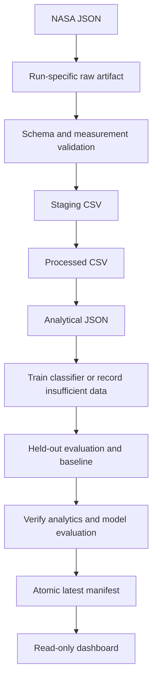

# Architecture notes

The DAG contains orchestration only. `api.py` handles bounded HTTP ingestion, `processing.py` validates/normalizes measurements, `analytics.py` calculates descriptive statistics, `modeling.py` trains and evaluates the educational classifier, and `storage.py` manages atomic file writes and output verification. These modules have no Airflow dependency in their business logic.

## Storage boundaries

Files live under `ASTEROID_ROOT`. Each run's date and hashed run ID determine stable names. The same run can retry safely because individual files are replaced atomically in their destination directory. Different runs do not overwrite each other's datasets. The final task publishes an atomic relative-path manifest, so the host and both containers can use the same files. `max_active_runs=1` prevents simultaneous DAG publications.

A failed validation does not change the manifest. Publishing a manifest is a data event, not proof that the Airflow scheduler recorded a successful run. Streamlit has no access to Airflow metadata and makes no run-status claim. A rerun of a previously published task may briefly cause a CSV/report mismatch; the dashboard reports unreadable outputs and asks for a refresh.

## Time and units

Query one day using UTC `data_interval_start`, with `logical_date` as fallback. Undated Airflow 3 manual runs use the preceding UTC day relative to the recorded `dag_run.run_after`, keeping retry behavior stable. The explicit cron data-interval timetable preserves completed-day semantics for scheduled runs. This makes scheduled daily intervals understandable and allows historical execution. The generation timestamp records when the JSON summary was computed, independently of the approach date. Velocity is km/s, distance and diameter are km. Estimated diameter is a midpoint, not a new scientific measurement.

## Validation policy

Fail on missing required values, non-booleans for hazard flags, invalid numeric strings, NaN, infinity, negative measurements, inverted diameter ranges, nonmatching approaches, and duplicate asteroid/date pairs. An explicitly empty date list is valid. Outputs are read again and the complete report statistics are recomputed before publication.

## Runtime

A single Airflow standalone container uses SQLite metadata on a named volume and LocalExecutor with parallelism 2. A second container runs Streamlit using the same installed package/image. Bind mounts expose application artifacts. Both ports bind to loopback. The configuration is intentionally limited to local educational use.

## Educational machine learning

The current day's validated CSV is split deterministically by unique asteroid ID.
Standardization and logistic regression fit only the training subset. Held-out
rows are used only for evaluation; no hyperparameter search is performed. At least
20 total objects and 4 of each class are required. Otherwise both ML tasks write
explicit skipped reports and the descriptive outputs remain usable.

The model artifact stores numeric parameters as JSON, along with train/test IDs,
feature order and a dataset fingerprint. Evaluation reconstructs the linear decision
function on standardized held-out features and compares it to NASA labels and a
training-majority baseline. Output validation recomputes the evaluation before the
manifest is published. Historical data are not pooled. The dashboard reads metrics
only and keeps NASA labels as the authoritative dataset classification.

This exercise approximates a label with incomplete orbital features; it does not
predict collisions, provide risk scores, or establish real-world predictive validity.
